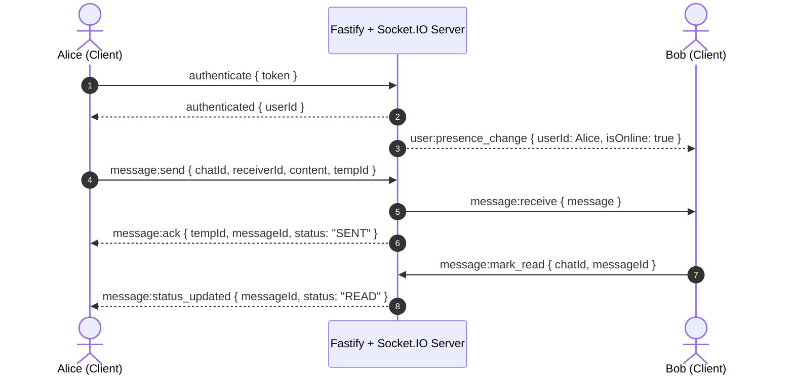
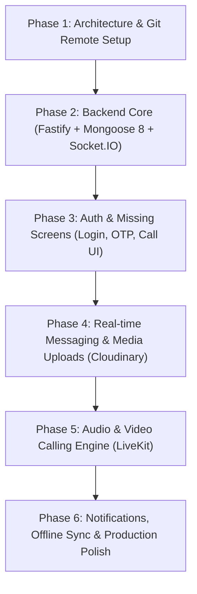

# 🦜 Cockatiel — Master Architecture & Implementation Plan (Cutting-Edge Stack)

> **Cockatiel** is a modern, high-performance, real-time messaging and voice/video calling cross-platform mobile application built with **React Native (Expo SDK 58 + React 19 + New Architecture)** and **Node.js (Fastify + Mongoose 8 + Socket.IO)**.

---

## 1. Project Overview & UI Specifications

All screen designs originate from the design mockups in [resources/](file:///f:/programming/student/react-native/cockatiel/resources).

### A. Core UI Screens (Implemented):
1. **Chats Screen ([resources/Chats.png](file:///f:/programming/student/react-native/cockatiel/resources/Chats.png)):**
   - Search bar with instant filtering.
   - Horizontal active story / online user avatar strip with story rings.
   - Chat list with last message, timestamp, online badge, and unread counter.
   - Bottom Tab Navigation (**Chats**, **Contacts**, **Calls**, **Profile**).
2. **Conversation Screen ([resources/Conversation.png](file:///f:/programming/student/react-native/cockatiel/resources/Conversation.png)):**
   - Header with active contact avatar, online status, audio call and video call actions.
   - Date pill ("TODAY").
   - Incoming bubble with message reactions (👍) and outgoing blue bubble with double check (`✓✓`) and reaction (❤️).
   - Rich image previews with captions.
   - Interactive message composer (`+` media attachment, text input, emoji picker, send button).
3. **Calls Screen ([resources/Calls.png](file:///f:/programming/student/react-native/cockatiel/resources/Calls.png)):**
   - Segmented filter control: **All** vs **Missed**.
   - Call logs with incoming, outgoing, and missed indicators (missed highlighted in red).
   - Call duration, timestamp, and details (`ℹ`) trigger.
4. **Contacts Screen ([resources/Contacts.png](file:///f:/programming/student/react-native/cockatiel/resources/Contacts.png)):**
   - Add contact action, search input.
   - Alphabetically grouped sections (A, B, C...) with interactive A-Z alphabet scrubber.
   - Contact status / bio lines and online indicators.
5. **Profile Screen ([resources/Profile.png](file:///f:/programming/student/react-native/cockatiel/resources/Profile.png)):**
   - Large avatar with camera badge, display name, and phone number.
   - About bio card.
   - Preferences (Notifications, Privacy & Security) + links to About and Support screens.
6. **New Message Modal ([resources/New message.png](file:///f:/programming/student/react-native/cockatiel/resources/New message.png)):**
   - Search input, "Create New Group", "Add New Contact", and suggested contacts.
7. **About & Support Screens ([resources/About.png](file:///f:/programming/student/react-native/cockatiel/resources/About.png), [resources/Support.png](file:///f:/programming/student/react-native/cockatiel/resources/Support.png)):**
   - App overview, guidelines, creator bio, Buy Me A Coffee link, and social links.

### B. Essential Expansion Screens (To Complete Full Functionality):
1. **Onboarding / Welcome Screen:** First-time launch welcome carousel introducing Cockatiel.
2. **Phone / Email Auth Screen:** Clean, modern phone number or email login screen.
3. **OTP Verification Screen:** 6-digit auto-focus pin input with resend timer.
4. **Profile Setup Screen:** First-time user profile picture picker, display name, and initial status setup.
5. **Call Ringing Screen (Incoming & Outgoing):** Fullscreen call interface with pulsing avatar, Accept (green) and Decline (red) buttons.
6. **Active Audio Call Screen:** In-call UI with Mute, Speakerphone, Bluetooth toggle, and End Call actions.
7. **Active Video Call Screen:** Real-time video stream with Picture-in-Picture (PiP) self-view, camera flip, audio mute, and video off toggles.
8. **Create Group Step-2 & Group Info Screens:** Group name, avatar picker, member list, and group admin controls.
9. **Fullscreen Media Viewer:** Pinch-to-zoom photo modal for chat images with save/share capabilities.

---

## 2. Modern 2026 Technology Stack

```
cockatiel/
├── frontend/             # React Native (Expo SDK 58 + React 19) Client Application
├── backend/              # Node.js + Fastify + Mongoose 8 + Socket.IO Server
├── resources/            # Design mockups, UI screenshots, and specifications
├── PLANNING.md           # Master architecture & technical plan
└── README.md             # Top-level documentation
```

### Frontend (`frontend/`):
- **Framework:** **React Native (Expo SDK 58+)** with **React 19** and **React Native 0.88.1**.
- **Routing:** **Expo Router v58** (Typed file-based navigation).
- **Language:** **TypeScript 5.x** in strict mode.
- **Styling:** **NativeWind (Tailwind CSS v4)** for rapid, clean component styling.
- **Iconography:** **lucide-react-native** for crisp vector icons.
- **List Performance:** **@shopify/flash-list** for smooth 60/120 FPS infinite message and contact feeds.
- **Real-Time Client:** **socket.io-client** configured for pure WebSocket transport.
- **Audio/Video Calling:** **LiveKit Client SDK** (`@livekit/react-native`) for ultra-low latency, crystal-clear voice and video streaming.

### Backend (`backend/`):
- **Runtime:** **Node.js LTS (ES Modules)**.
- **HTTP Engine:** **Fastify** — modern, async-first, and 2-3x faster than Express with native JSON schema validation.
- **Database:** **MongoDB Atlas (M0 Free Tier / Local MongoDB)** — ideal for polymorphic chat messages and embedded sub-documents.
- **ODM:** **Mongoose 8.x** — latest type-safe schema modeling, async hooks, and validation.
- **Validation:** **Zod** for end-to-end type inference and request payload validation.
- **Real-time Engine:** **Socket.IO v4** (WebSockets transport, room-based presence, typing broadcast, and read receipts).
- **Authentication:** **JWT (JSON Web Tokens)** with Access & Refresh Token rotation and secure password hashing.
- **Media CDN:** **Cloudinary** (25 monthly credits pool) for automatic image optimization, thumbnails, and media delivery.
- **Voice/Video Infrastructure:** **LiveKit Server / Cloud** (or WebRTC signaling) for modern media routing.
- **Push Notifications:** **Expo Push Notification Service / Firebase Cloud Messaging (FCM)**.

---

## 3. Database Schema Blueprint (MongoDB / Mongoose 8)

```typescript
import { Schema, model, Document, Types } from 'mongoose';

// 1. User Model
export interface IUser extends Document {
  phoneNumber: string;
  username?: string;
  displayName: string;
  avatarUrl?: string;
  about: string;
  isOnline: boolean;
  lastSeen: Date;
  pushToken?: string;
}

const UserSchema = new Schema<IUser>({
  phoneNumber: { type: String, required: true, unique: true, index: true },
  username: { type: String, sparse: true, unique: true },
  displayName: { type: String, required: true },
  avatarUrl: { type: String, default: null },
  about: { type: String, default: 'Living life one bubble at a time 🫧' },
  isOnline: { type: Boolean, default: false },
  lastSeen: { type: Date, default: Date.now },
  pushToken: { type: String, default: null },
}, { timestamps: true });

// 2. Chat / Conversation Model
export interface IChat extends Document {
  isGroup: boolean;
  groupName?: string;
  groupAvatar?: string;
  participants: Types.ObjectId[];
  admins: Types.ObjectId[];
  lastMessage?: {
    text: string;
    senderId: Types.ObjectId;
    timestamp: Date;
  };
  unreadCounts: Map<string, number>;
}

const ChatSchema = new Schema<IChat>({
  isGroup: { type: Boolean, default: false },
  groupName: { type: String, default: null },
  groupAvatar: { type: String, default: null },
  participants: [{ type: Schema.Types.ObjectId, ref: 'User', index: true }],
  admins: [{ type: Schema.Types.ObjectId, ref: 'User' }],
  lastMessage: {
    text: { type: String },
    senderId: { type: Schema.Types.ObjectId, ref: 'User' },
    timestamp: { type: Date, default: Date.now },
  },
  unreadCounts: { type: Map, of: Number, default: {} },
}, { timestamps: true });

// 3. Message Model
export interface IMessage extends Document {
  chatId: Types.ObjectId;
  senderId: Types.ObjectId;
  content?: string;
  mediaUrl?: string;
  mediaType?: 'IMAGE' | 'VIDEO' | 'AUDIO' | 'DOCUMENT';
  status: 'SENT' | 'DELIVERED' | 'READ';
  reactions: Array<{
    userId: Types.ObjectId;
    emoji: string;
    createdAt: Date;
  }>;
  readBy: Types.ObjectId[];
}

const MessageSchema = new Schema<IMessage>({
  chatId: { type: Schema.Types.ObjectId, ref: 'Chat', required: true, index: true },
  senderId: { type: Schema.Types.ObjectId, ref: 'User', required: true, index: true },
  content: { type: String, default: null },
  mediaUrl: { type: String, default: null },
  mediaType: { type: String, enum: ['IMAGE', 'VIDEO', 'AUDIO', 'DOCUMENT', null], default: null },
  status: { type: String, enum: ['SENT', 'DELIVERED', 'READ'], default: 'SENT' },
  reactions: [{
    userId: { type: Schema.Types.ObjectId, ref: 'User' },
    emoji: { type: String, required: true },
    createdAt: { type: Date, default: Date.now },
  }],
  readBy: [{ type: Schema.Types.ObjectId, ref: 'User' }],
}, { timestamps: true });

// 4. Call Log Model
export interface ICallLog extends Document {
  callerId: Types.ObjectId;
  receiverId: Types.ObjectId;
  callType: 'audio' | 'video';
  direction: 'incoming' | 'outgoing' | 'missed';
  duration?: string;
  roomName: string;
}

const CallLogSchema = new Schema<ICallLog>({
  callerId: { type: Schema.Types.ObjectId, ref: 'User', required: true, index: true },
  receiverId: { type: Schema.Types.ObjectId, ref: 'User', required: true, index: true },
  callType: { type: String, enum: ['audio', 'video'], required: true },
  direction: { type: String, enum: ['incoming', 'outgoing', 'missed'], required: true },
  duration: { type: String, default: null },
  roomName: { type: String, required: true },
}, { timestamps: true });
```

---

## 4. Real-time Event Contract (Socket.IO v4)



### Event Specifications:
* **Presence:**
  - `user:join` $\rightarrow$ User registers active socket connection.
  - `user:leave` $\rightarrow$ Disconnect triggers offline presence broadcast and updates `lastSeen`.
* **Instant Messaging:**
  - `message:send` $\rightarrow$ Sends payload with optimistic UI `tempId`.
  - `message:receive` $\rightarrow$ Delivered to receiver's private room.
  - `message:ack` $\rightarrow$ Confirms message persistence to sender.
  - `message:react` $\rightarrow$ Broadcasts reaction emoji updates.
* **Typing Indicator:**
  - `typing:start` & `typing:stop` with 2-second debounce.
* **Voice / Video Calling (LiveKit / Signaling):**
  - `call:initiate` $\rightarrow$ Caller initiates call room.
  - `call:incoming` $\rightarrow$ Receiver receives full-screen incoming alert.
  - `call:accepted` $\rightarrow$ Both peers join LiveKit audio/video room.
  - `call:rejected` / `call:ended` $\rightarrow$ Closes media session and logs call entry.

---

## 5. Execution Roadmap



1. **Phase 1: Architecture & Git Remote Setup (COMPLETED ✅)**
   - Git repository initialized and connected to `https://github.com/promahbubul/cockatiel.git`.
   - Core 8 screens implemented in React Native Expo with New Architecture.
   - Master architecture locked with cutting-edge stack.
2. **Phase 2: Backend Core Setup**
   - Initialize Fastify TypeScript server in `backend/`.
   - Setup MongoDB Atlas connection with Mongoose 8 models.
   - Implement Auth endpoints (phone OTP / JWT login) and Zod validation schemas.
   - Configure Socket.IO server with pure WebSocket transport.
3. **Phase 3: Auth & Expansion Screens**
   - Implement Welcome, Login, OTP, and Profile Setup screens.
   - Implement Incoming/Outgoing Call Screen and Active Call interfaces.
4. **Phase 4: Real-time Integration & Media**
   - Integrate `socket.io-client` with React Native state management.
   - Connect Cloudinary image upload pipeline for chat photos and avatars.
5. **Phase 5: Voice & Video Calling**
   - Integrate LiveKit client SDK for HD audio/video calls.
6. **Phase 6: Notifications & Production Readiness**
   - Background push notifications and final polish.
