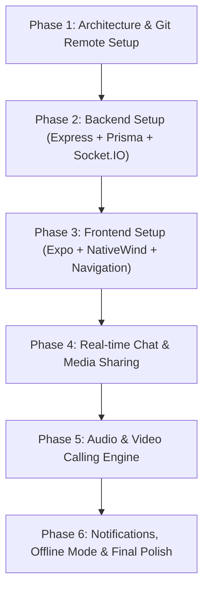

# 🦜 Cockatiel — Project Architecture & Implementation Plan

> **Cockatiel** is a high-performance, real-time messaging and voice/video calling cross-platform mobile application built with React Native (Expo) and Node.js.

---

## 1. Project Overview & Design Analysis

All user interface screens are derived from the UI specifications located in the [resources/](file:///f:/programming/student/react-native/cockatiel/resources) directory.

### UI Screens & Feature Breakdown:
1. **Chats Screen ([resources/Chats.png](file:///f:/programming/student/react-native/cockatiel/resources/Chats.png)):**
   - Search bar for quick chat filtering.
   - Horizontal stories / online active contact avatars strip.
   - Conversation list with avatar, online indicator, contact/group name, last message preview, timestamp, and unread badge count.
   - Quick action floating/header button to compose a new message.
   - Bottom tab navigation: **Chats**, **Contacts**, **Calls**, **Profile**.

2. **Conversation Screen ([resources/Conversation.png](file:///f:/programming/student/react-native/cockatiel/resources/Conversation.png)):**
   - Top Header: Back navigation, Avatar with real-time online status badge, Name, Voice Call button, Video Call button.
   - Date separator indicators (e.g., "TODAY").
   - Incoming message bubble with sender avatar, message content, timestamp, and message reaction badges (e.g., 👍, ❤️).
   - Outgoing message bubble (brand blue accent) with timestamp and double-check read status (`✓✓`).
   - Image & media attachment display with rounded previews and captions.
   - Message Composer: Attachment button (`+`), text input ("Type a message..."), emoji picker icon, and send button.

3. **Calls Screen ([resources/Calls.png](file:///f:/programming/student/react-native/cockatiel/resources/Calls.png)):**
   - Top header with dial/new call action.
   - Segmented control filter: **All** vs **Missed**.
   - Call log list items: Avatar, contact name (highlighted in red for missed calls), call type indicator icon (incoming/outgoing/missed, audio/video), duration label, timestamp, and details (`ℹ`) action.

4. **Contacts Screen ([resources/Contacts.png](file:///f:/programming/student/react-native/cockatiel/resources/Contacts.png)):**
   - Search contacts input.
   - Add new contact button.
   - Alphabetical section headers (A, B, C...) with interactive A-Z alphabet scrubber on the right edge.
   - Contact list items with avatar, online status indicator, contact name, and custom status/bio text.

5. **Profile Screen ([resources/Profile.png](file:///f:/programming/student/react-native/cockatiel/resources/Profile.png)):**
   - User avatar with camera upload badge.
   - Display name and phone number.
   - Bio / About section ("Living life one bubble at a time...").
   - Preferences menu items (Notifications, Privacy & Security, Two-step verification, etc.).

6. **New Message Sheet ([resources/New message.png](file:///f:/programming/student/react-native/cockatiel/resources/New message.png)):**
   - Search by name or phone number.
   - "Create New Group" action.
   - "Add New Contact" action.
   - "Suggested" contacts list.

7. **About & Support Screens ([resources/About.png](file:///f:/programming/student/react-native/cockatiel/resources/About.png), [resources/Support.png](file:///f:/programming/student/react-native/cockatiel/resources/Support.png)):**
   - Project info, open source credits, creator profile, and support links.

---

## 2. Technology Stack & Rationale

```
cockatiel/
├── frontend/             # React Native (Expo) Client Application
├── backend/              # Node.js + Express + Socket.IO Server
├── resources/            # Design assets & mockups
├── PLANNING.md           # Master architecture & plan
└── README.md             # Project documentation
```

### Frontend (`frontend/`):
- **Framework:** **React Native with Expo (SDK 52+)**
  - Cross-platform native performance (Android & iOS).
  - Fast iteration with Expo Go and prebuild capabilities.
- **Language:** **TypeScript** for end-to-end type safety.
- **Routing & Navigation:** **Expo Router** (File-based routing with native tabs and modal stacks).
- **Styling:** **NativeWind (Tailwind CSS v4)** for rapid UI reproduction matching designs.
- **List Optimization:** **@shopify/flash-list** for smooth scrolling across thousands of messages and contacts.
- **Icons:** **lucide-react-native** for clean, modern iconography.
- **Real-time Client:** **socket.io-client** for real-time messaging, typing, and presence.
- **Audio/Video Engine:** **react-native-webrtc** or **LiveKit Client SDK** for voice and video streaming.

### Backend (`backend/`):
- **Runtime & Server:** **Node.js + Express.js (TypeScript)**
- **Real-time Engine:** **Socket.IO** (WebSockets with automatic polling fallback, presence rooms, and acknowledgment callbacks).
- **Database:** **PostgreSQL** (Hosted locally or via Supabase / Neon / Railway).
- **ORM:** **Prisma ORM** (Type-safe models, clean migrations, and relations).
- **In-Memory Cache / PubSub:** **Redis** (Used for user online/offline presence tracking, typing indicators, and horizontal scaling).
- **Authentication:** **JWT (JSON Web Tokens)** + Refresh Token rotation, phone/email login.
- **Media Storage:** **Cloudinary** or **AWS S3 / Supabase Storage** for profile pictures and media messages.
- **Push Notifications:** **Firebase Cloud Messaging (FCM)** / **Expo Push Notification Service**.

---

## 3. Database Schema Blueprint (Prisma)

```prisma
datasource db {
  provider = "postgresql"
  url      = env("DATABASE_URL")
}

generator client {
  provider = "prisma-client-js"
}

model User {
  id            String    @id @default(uuid())
  phoneNumber   String    @unique
  username      String?   @unique
  displayName   String
  avatarUrl     String?
  about         String?   @default("Available")
  isOnline      Boolean   @default(false)
  lastSeen      DateTime  @default(now())
  createdAt     DateTime  @default(now())
  updatedAt     DateTime  @updatedAt

  contacts      Contact[] @relation("UserContacts")
  chatMembers   ChatParticipant[]
  messages      Message[]
  reactions     MessageReaction[]
  outgoingCalls CallLog[] @relation("Caller")
  incomingCalls CallLog[] @relation("Receiver")
}

model Contact {
  id            String   @id @default(uuid())
  userId        String
  contactUserId String
  nickname      String?
  createdAt     DateTime @default(now())

  user          User     @relation("UserContacts", fields: [userId], references: [id], onDelete: Cascade)
}

model Chat {
  id            String            @id @default(uuid())
  isGroup       Boolean           @default(false)
  groupName     String?
  groupAvatar   String?
  createdAt     DateTime          @default(now())
  updatedAt     DateTime          @updatedAt

  participants  ChatParticipant[]
  messages      Message[]
}

model ChatParticipant {
  id            String    @id @default(uuid())
  chatId        String
  userId        String
  role          String    @default("MEMBER") // ADMIN | MEMBER
  unreadCount   Int       @default(0)
  lastReadAt    DateTime  @default(now())

  chat          Chat      @relation(fields: [chatId], references: [id], onDelete: Cascade)
  user          User      @relation(fields: [userId], references: [id], onDelete: Cascade)

  @@unique([chatId, userId])
}

model Message {
  id            String            @id @default(uuid())
  chatId        String
  senderId      String
  content       String?
  mediaUrl      String?
  mediaType     String?           // IMAGE | VIDEO | AUDIO | DOCUMENT
  status        String            @default("SENT") // SENT | DELIVERED | READ
  createdAt     DateTime          @default(now())
  updatedAt     DateTime          @updatedAt

  chat          Chat              @relation(fields: [chatId], references: [id], onDelete: Cascade)
  sender        User              @relation(fields: [senderId], references: [id], onDelete: Cascade)
  reactions     MessageReaction[]
}

model MessageReaction {
  id            String   @id @default(uuid())
  messageId     String
  userId        String
  emoji         String   // e.g. "👍", "❤️"
  createdAt     DateTime @default(now())

  message       Message  @relation(fields: [messageId], references: [id], onDelete: Cascade)
  user          User     @relation(fields: [userId], references: [id], onDelete: Cascade)

  @@unique([messageId, userId])
}

model CallLog {
  id            String    @id @default(uuid())
  callerId      String
  receiverId    String
  callType      String    // AUDIO | VIDEO
  status        String    // MISSED | COMPLETED | REJECTED | BUSY
  durationSec   Int       @default(0)
  startedAt     DateTime  @default(now())
  endedAt       DateTime?

  caller        User      @relation("Caller", fields: [callerId], references: [id], onDelete: Cascade)
  receiver      User      @relation("Receiver", fields: [receiverId], references: [id], onDelete: Cascade)
}
```

---

## 4. Real-time Event Contract (Socket.IO)

### Connection & Presence:
- `client -> server`: `user:join { userId }`
- `server -> all`: `user:presence_change { userId, isOnline, lastSeen }`

### Messaging:
- `client -> server`: `message:send { chatId, receiverId, content, mediaUrl, mediaType, tempId }`
- `server -> receiver`: `message:receive { message }`
- `server -> sender`: `message:ack { tempId, messageId, status: "SENT" }`
- `client -> server`: `message:mark_read { chatId, messageId }`
- `server -> sender`: `message:status_updated { messageId, status: "READ" }`
- `client -> server`: `message:react { messageId, emoji }`
- `server -> chat`: `message:reaction_updated { messageId, userId, emoji }`

### Typing Indicator:
- `client -> server`: `typing:start { chatId }`
- `client -> server`: `typing:stop { chatId }`
- `server -> chat`: `user:typing { chatId, userId }`

### WebRTC Voice / Video Calling:
- `caller -> server`: `call:initiate { receiverId, callType: 'AUDIO'|'VIDEO' }`
- `server -> receiver`: `call:incoming { callId, caller, callType }`
- `receiver -> server`: `call:answer { callId, accept: boolean }`
- `peer -> server -> peer`: `call:signal { callId, sdpOffer, sdpAnswer, iceCandidate }`
- `peer -> server -> peer`: `call:end { callId, reason }`

---

## 5. Step-by-Step Implementation Roadmap



1. **Phase 1: Architecture & Git Remote Setup (Current Phase)**
   - Initialize git repository, configure `.gitignore`, add remote origin `https://github.com/promahbubul/cockatiel.git`.
   - Establish `frontend/`, `backend/`, and master `PLANNING.md`.

2. **Phase 2: Backend Core**
   - Initialize Node.js TypeScript project in `backend/`.
   - Set up Prisma ORM, PostgreSQL connection, and migration scripts.
   - Implement Auth endpoints (Signup, Login, Profile updates).
   - Configure Socket.IO server with authentication middleware and presence manager.

3. **Phase 3: Frontend Foundation & UI Implementation**
   - Initialize Expo project with TypeScript and Expo Router in `frontend/`.
   - Configure NativeWind (Tailwind CSS) and install custom fonts/icons.
   - Build UI screens strictly matching designs:
     - Bottom Tab Navigator (`Chats`, `Contacts`, `Calls`, `Profile`).
     - Chat list screen with story avatars and unread badges.
     - Conversation screen with speech bubbles, reactions, and media input.
     - Calls screen with segmented filter (All / Missed).
     - Contacts screen with A-Z alphabet index.
     - Profile screen and About/Support pages.

4. **Phase 4: Real-time Chat & Media**
   - Connect client to Socket.IO backend.
   - Implement optimistic message rendering for instant responsiveness.
   - Implement typing indicators, read receipts (`✓✓`), and reaction pickers.
   - Image picker and upload pipeline (Cloudinary / S3).

5. **Phase 5: Audio & Video Calling**
   - WebRTC integration for peer-to-peer audio and video calls.
   - Incoming call ring screen & active call interface with mute/speaker toggles.
   - Call history logging (duration, status, missed call alerts).

6. **Phase 6: Push Notifications & Polish**
   - Expo Push Notifications / FCM for background call and message alerts.
   - App icon, splash screen, and release build readiness.
